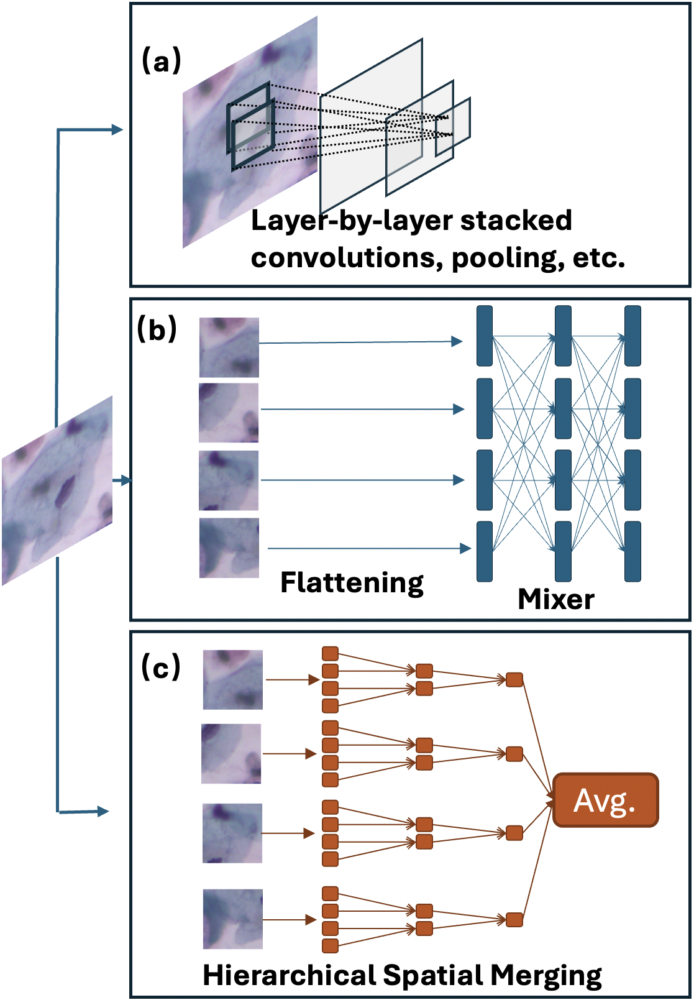

# HSMTA

This repository provides the PyTorch implementation of **Hierarchical Spatially Merged Token Averager (HSMTA)**, presented in the manuscript **"The Simpler, the Better: A Lightweight Hierarchical Token Averager for Single-Label Microscopic Specimen Image Classification"**, accepted for publication in *IEEE Transactions on Biomedical Engineering*.

HSMTA progressively reorganizes and merges local spatial elements into hierarchical morphology descriptors, followed by simple token averaging for image-level classification. The repository also includes **HSMTA-SRR**, an SRR-inspired sparsity-regularized variant used to analyze the formation of intermediate representations.

### Figure 1: Accuracy vs. computational cost

Comparison of classification accuracy and GMACs on the DSCC dataset.


### Figure 2: Overview of the proposed approach

Comparison of (a) conventional CNN processing, (b) token-mixer-based processing, and (c) the proposed hierarchical spatial merging and token averaging.



### Environment and Dependencies

The code is implemented in Python using PyTorch. Training requires a CUDA-enabled GPU. The uploaded code does not specify a verified set of package versions, so the dependencies below are provided without version pins.

Main Python dependencies:

- `torch`, `torchvision`
- `timm`
- `numpy`, `scipy`, `pandas`
- `scikit-learn`, `scikit-image`
- `opencv-python`, `matplotlib`, `tqdm`
- `kmeans-pytorch`
- `bagnets` (the training script imports `bagnets.pytorchnet`)

### Source Code

The following layout assumes the two uploaded model files are renamed to match the module imports in the training script: `hsmta(20261013-142523).py` → `hsmta.py` and `hsmta_reference(1).py` → `hsmta_reference.py`.

```text
HSMTA/
├── hsmta.py
├── hsmta_srr.py
├── hsmta_reference.py
├── my_utils.py
├── train_models_DSCC_5folds.py
├── accuracy_vs_gmacs.png
└── structure(6).png
```

### Dataset

The manuscript evaluates **DSCC**, **SIPaKMeD**, **C-NMC**, and **DeFungi**. The training script currently provided in this repository is for the **DSCC five-fold experiment**.

Download and prepare the DSCC dataset separately. From the repository root, arrange each fold as follows (preserving the `splited` directory name expected by the code):

```text
datasets/
└── DSCC/
    └── splited/
        └── seed_0_5fold/
            ├── 0/
            │   ├── train/
            │   │   ├── class_1/
            │   │   ├── class_2/
            │   │   └── class_3/
            │   └── validation/
            │       ├── class_1/
            │       ├── class_2/
            │       └── class_3/
            ├── 1/
            ├── 2/
            ├── 3/
            └── 4/
```

Each class directory should contain the corresponding image files. Keep the class names and their alphabetical ordering consistent across all folds, as the training script uses `torchvision.datasets.ImageFolder`. The dataset and fold files are not included in this repository.

### Train

Run the commands below from the repository root.

**HSMTA (main model), DSCC fold 0:**

```bash
python train_models_DSCC_5folds.py --m hm --fold 0
```

**HSMTA-SRR, DSCC fold 0:**

```bash
python train_models_DSCC_5folds.py --m hms --fold 0
```

For the five DSCC folds, repeat with `--fold 0` through `--fold 4`.

The training script uses 500 epochs, SGD with momentum 0.9 and cosine learning-rate annealing, batch size 16, and an initial learning rate of 0.002. For HSMTA and HSMTA-SRR, the input resolution is 228 × 228. GPU selection is currently set in the script through `CUDA_VISIBLE_DEVICES="0"`.

### Evaluation and Outputs

The DSCC training script evaluates the saved model on the specified `validation` directory and writes its training and evaluation logs, together with model checkpoints, under the relative directory `Results_DSCC/`.

The supplied files do not include pretrained checkpoints or a separate inference command-line script. Training scripts for the other datasets studied in the manuscript are not included in this upload.
